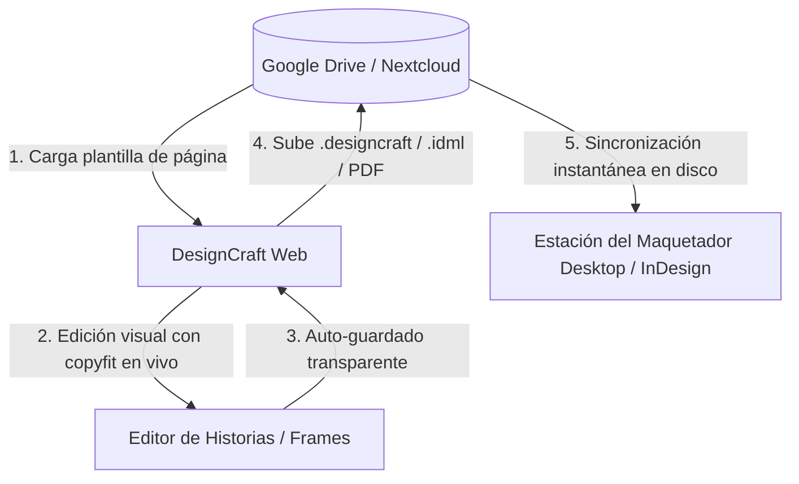

# Roadmap: Integración de Google Drive & Flujo Cloud Editorial en DesignCraft

## 1. Visión y Enfoque Estratégico

### ❌ Lo que se descarta definitivamente de `idml-injector-pro`
- **Etiquetado manual ciego (`##TITULO`, `##CUERPO`):** Innecesario. El redactor humano trabaja mucho mejor y sin errores de sintaxis directamente en el **Editor de Historias** o sobre los marcos de la página.
- **Motor Scribus y scripts Python (`preview-service`):** Descartados por lentos (timeouts de 180s), inexactos y de mala fidelidad gráfica.
- **Heurísticas de copyfit aproximadas:** Reemplazadas por el motor tipográfico nativo de DesignCraft (`HarfRust/Rustybuzz`), que mide el desborde exacto en milisegundos.

### ✅ Lo que se rescata e integra de `idml-injector-pro`
- **Autenticación OAuth2 con Google Drive y Nextcloud** (`services/googleAuth.ts`, `services/nextcloudAuth.ts`): Sesión segura, refresco automático de tokens y persistencia local.
- **Selector jerárquico de carpetas de producción** (`components/DestinationFolderSelector.tsx`): Estructura estándar de prensa:
  $$\text{Carpeta Raíz} \longrightarrow \text{Edición / Fecha (p. ej. 2026-10-16)} \longrightarrow \text{Página / Sección (p. ej. Pág 04 - Política)}$$
- **Descarga y subida directa en la nube:** Apertura de la plantilla desde Google Drive y guardado del documento final (`.designcraft`, `.idml`, `.pdf`) en la carpeta compartida de la página.
- **Auditoría editorial:** Registro automático de quién cerró o guardó cada página en Google Sheets o base de datos.

---

## 2. Arquitectura del Flujo Unificado

1. **El Redactor** entra al navegador y conecta su cuenta institucional de Google Drive en 1 clic.
2. Selecciona la **Edición del día** y la **Página** que le asignaron.
3. Se abre la maqueta con el **Editor de Historias** (hoja blanca, texto negro uniforme, semáforo de copyfit en tiempo real).
4. El redactor escribe y ajusta hasta que el semáforo marque `Fits frame ✓`.
5. Al pulsar **Guardar**, el documento se deposita automáticamente en la carpeta de esa página en Google Drive.
6. **El Maquetador**, que tiene la carpeta compartida sincronizada en su ordenador, recibe el archivo listo para revisión final o cierre.

---

## 3. Fases de Implementación

### Fase 1: Extracción del Núcleo Cloud de `idml-injector-pro`
- [ ] Extraer el módulo de autenticación Google OAuth2 (`googleAuth.ts`) y almacenamiento (`driveApi.ts`, `StorageManager.ts`).
- [ ] Configurar variables de entorno `.env` en la aplicación web:
  - `VITE_GOOGLE_DRIVE_CLIENT_ID`
  - `VITE_GOOGLE_DRIVE_API_KEY`
  - `VITE_DRIVE_TEMPLATES_FOLDER_ID` (carpeta con plantillas maestras)
  - `VITE_DRIVE_DESTINATION_FOLDER_ID` (carpeta de ediciones del diario)

### Fase 2: Componente Selector de Edición y Página en la Web
- [ ] Integrar el diálogo de selección de destino (`DestinationFolderSelector`):
  - Nivel 1: Lista desplegable de Ediciones (ordenadas por fecha descendente).
  - Nivel 2: Lista de Páginas dentro de esa edición.
- [ ] Botón de conexión/desconexión de Google Drive en la barra superior con avatar del redactor.

### Fase 3: Puente de Carga y Guardado Bidireccional
- [ ] **Lectura:** Descargar el archivo `.idml` o `.designcraft` de la página seleccionada en Drive y cargarlo en la sesión de DesignCraft.
- [ ] **Guardado:** Al ejecutar `app.save`, además de la copia local atómica, subir el archivo `.designcraft` y opcionalmente el `.idml` a la carpeta de la página en Drive.
- [ ] Subida del **PDF de Prensa de baja/alta resolución** generado por DesignCraft (`/api/documents/{id}/pdf`) para que los editores puedan ver el resultado sin abrir el software.

### Fase 4: Sincronización de Imágenes y Assets
- [ ] Cuando el redactor arrastre o coloque una foto en un marco, la imagen se sube a la subcarpeta `Fotos/` o `Links/` dentro de la carpeta de la página en Drive.
- [ ] Los vínculos se generan con nombres relativos para que el maquetador en InDesign o DesignCraft Desktop no tenga vínculos rotos.

### Fase 5: Auditoría y Telemetría Editorial (Opcional)
- [ ] Registrar en Google Sheets (`sheetsApi.ts`):
  - Fecha y hora del guardado.
  - Redactor / usuario.
  - Edición y página.
  - Estado del copyfit (si entró completo o con desborde).

---

## 4. Estado de los Componentes y Compatibilidad

| Componente | Origen | Estado actual | Acción |
| :--- | :--- | :--- | :--- |
| **Auth Google OAuth2** | `idml-injector-pro` | Funcional y probado | Migrar código TS limpio |
| **Selector de Edición/Pág** | `idml-injector-pro` | Funcional y probado | Adaptar al UI de DesignCraft |
| **Editor de Historias** | DesignCraft | 100% optimizado y sin freeze | Mantener |
| **Copyfit en vivo** | DesignCraft | Nativo en Rust (milisegundos) | Mantener |
| **Motor de Preview** | DesignCraft | Canvas WebAssembly y PDF/X-4 nativo | Mantener |
| **Scribus / Python** | `idml-injector-pro` | Descartado | Eliminar por completo |
