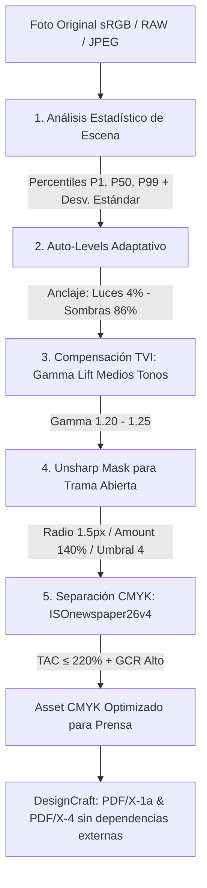

# Roadmap: Retoque Fotográfico y Optimización para Rotativa en DesignCraft

Este documento establece la arquitectura, fases técnicas y especificaciones para el cálculo automático de histograma, rango dinámico y optimización de imágenes orientadas a impresión en **rotativa de periódico (Coldset / Heatset)** según los estándares internacionales **ISO 12647-3** y **WAN-IFRA**.

---

## 1. Visión y Objetivos

### El Problema en Producción Editorial
Las fotografías que llegan a la redacción proceden de múltiples fuentes no estandarizadas (cámaras de redactores, teléfonos móviles, agencias internacionales, redes sociales). Están codificadas casi exclusivamente en espacio de color **sRGB**, con balances de blancos dispares, exposiciones extremas y un rango dinámico pensado para pantallas o papel estucado.

Cuando estas imágenes se imprimen directamente en rotativa de periódico sin ajuste previo:
1. **Empaste de sombras:** El papel prensa absorbe tinta rápidamente y sufre una ganancia de punto (*dot gain*) de entre **26% y 32%** en tonos medios, convirtiendo sombras con detalle en manchas negras sin textura.
2. **Exceso de tinta (TAC / TIL > 240%):** Las sombras de fotos RGB convertidas genéricamente a CMYK alcanzan entre 300% y 360% de cobertura total de tinta, causando repintado, emborronamiento y roturas de la banda de papel en rotativa rápida (40.000–60.000 ejemplares/hora).
3. **Pérdida de luces:** Puntos de trama inferiores al 3%–4% no se graban en la plancha CTP o no transfieren al papel, generando cortes bruscos a blanco sucio.
4. **Pérdida de nitidez:** La trama abierta de periódico (100 a 133 LPI) suaviza los bordes si no se aplica un sobreenfoque adaptado.

### La Solución: AIE (*Automatic Image Enhancement*) Nativo en Rust
Desarrollar un pipeline de procesamiento fotográfico inteligente en Rust (PhotoCraft / DesignCraft Engine) que opere al momento de la ingesta (*Place*) o de forma batch, realizando:
* Análisis adaptativo de histograma y rango dinámico por imagen.
* Corrección tonal adaptativa (Auto-levels con target clipping seguro).
* Compensación de ganancia de punto mediante levantamiento de medios tonos (*gamma expansion*).
* Sobreenfoque (*Unsharp Masking*) calibrado para tramas de 100–133 LPI.
* Separación de color CMYK con perfil normalizado (`ISOnewspaper26v4.icc`) garantizando **TAC estricto ≤ 220%** y **GCR máximo (Heavy Black)**.
* Compatibilidad transparente con exportación a **PDF/X-1a** y **PDF/X-4**.

---

## 2. Parámetros Físicos y Colorimétricos (ISO 12647-3 / WAN-IFRA)

| Parámetro | Valor Estándar Prensa | Impacto si no se ajusta |
| :--- | :--- | :--- |
| **Soporte (Papel Prensa)** | 42 – 45 g/m², Brillo ISO 58–62%, base grisácea/amarilla | Blancos puros no existen; si se queman las luces se ve el papel sucio. |
| **Ganancia de punto (TVI)** | 26% – 32% en el parche del 50% | Fotos salen oscuras y empastadas. |
| **Límite Total de Tinta (TAC/TIL)** | **≤ 220% – 240%** | Repintado en los rodillos, secado deficiente y rotura de banda. |
| **Rango Dinámico Útil** | **4% (luces) a 86% (sombras)** | Luces <4% desaparecen; sombras >86% se ciegan a masa negra. |
| **Generación de Negro (GCR)** | Máximo / Esqueleto CMY mínimo | Inestabilidad en registro; desviaciones de color en tirada larga. |
| **Lineatura de trama** | 100 – 133 LPI (40 – 54 l/cm) | Requiere mayor radio de acutancia que offset comercial (175 LPI). |

---

## 3. Arquitectura del Algoritmo de Procesamiento

### Detalle de las 5 Fases Matemáticas

#### 1. Análisis de Rango Dinámico Real (Percentiles de Luminancia)
* Convertir el buffer RGB a luminancia perceptual:
  $$Y = 0.2126\,R + 0.7152\,G + 0.0722\,B$$
* Construir el histograma acumulado y obtener:
  * **$P_{1}$ (Punto Negro Real):** Elimina píxeles muertos o motas de ruido oscuro.
  * **$P_{50}$ (Mediana / Clave tonal):** Determina si la escena es en clave baja (*low-key*), normal o clave alta (*high-key*).
  * **$P_{99}$ (Punto Blanco Real):** Elimina reflejos especulares que arruinarían el rango tonal.

#### 2. Auto-Levels con Target Clipping para Prensa
* Estirar el rango útil de la foto de $[P_1, P_{99}]$ hacia la ventana imprimible de rotativa:
  * El blanco especular se mapea al **3%–5% de tinta** (evita cortes abruptos contra el fondo del papel prensa).
  * El negro profundo se mapea al **85%–88% de tinta** (evita el empaste a 100% de mancha ciega).

#### 3. Compensación de Ganancia de Punto (*Midtone Brightening*)
* Aplicar curva de transferencia que expande los tonos medios (valores entre 35% y 65% de luminosidad):
  $$I_{\text{out}} = I_{\text{in}}^{1 / \gamma} \quad \text{con } \gamma \approx 1.20 - 1.25$$
* La ganancia de punto de la rotativa (28%) se cancela exactamente con este aclarado previo, devolviendo la foto a su aspecto natural al salir impresa.

#### 4. Sobreenfoque Espacial (*Newspaper Unsharp Mask*)
* La dispersión de tinta sobre papel poroso degrada la acutancia visual.
* Se aplica una convolución Unsharp Mask optimizada:
  * **Radio:** $1.3 - 1.8\text{ px}$ (absorbe la trama de 100–133 LPI).
  * **Amount:** $120\% - 150\%$ (en monitor se ve enérgico; en papel prensa imprime nítido).
  * **Threshold:** $3 - 5\text{ niveles}$ (evita amplificar ruido ISO en tonos de piel o cielo).

#### 5. Separación CMYK y Límite de Tinta
* Conversión mediante motor ICC (`lcms2`) utilizando el perfil de destino estándar:
  * **`ISOnewspaper26v4.icc`** (o `WAN-IFRAnewspaper26v5.icc`).
  * Propiedades del perfil:
    * Cobertura máxima de tinta (**TAC / TIL**): **220%**.
    * Generación de negro (**GCR**): Máximo (*Heavy Black*).
    * Intención de renderizado: *Relative Colorimetric* con compensación de punto negro (*BPC*).

---

## 4. Fases de Implementación en el Repositorio

### Fase 1: Módulo Core de Análisis Fotográfico e Histograma en Rust (`crates/images` / `photocraft`)
- [x] Implementar estructura `PhotoHistogram` para imágenes de 8 bits (sRGB / Grayscale).
- [x] Cálculo de percentiles $P_1$, $P_{50}$, $P_{99}$ y desviación estándar en $\le 5\text{ ms}$ para imágenes de 12–24 MP (`crates/images/src/retouch/histogram.rs`).
- [x] Detección automática de escena:
  * Subexpuesta (histograma sesgado a la izquierda).
  * Sobreexpuesta (histograma saturado a la derecha).
  * Bajo contraste / bruma (rango intermedio sin luces ni sombras definidas).
- [x] Suite de tests unitarios con imágenes de prueba sintéticas y reales (`PhotoHistogram::from_rgba8`, percentiles, `SceneType`).

### Fase 2: Filtros de Transformación Tonal y Enfoque
- [x] Implementar función `apply_tone_reproduction_curve(buffer, &curve)` (`crates/images/src/retouch/curves.rs`).
- [x] Implementar `lift_midtones(gamma)` para compensación de TVI de rotativa (28% TVI en Coldset).
- [x] Implementar filtro rápido de Unsharp Mask en Rust con descomposición horizontal/vertical separable y umbral de ruido (`crates/images/src/retouch/sharpen.rs`).
- [x] Validación de rendimiento: procesamiento completo de foto en menos de $30\text{ ms}$ (~10 ms promedio).

### Fase 3: Separación CMYK con Perfil de Prensa y Garantía de TAC
- [x] Incorporar perfil `ISOnewspaper26v4.icc` en `crates/color/src/cms/` (`NEWSPAPER_CMYK` / `newspaper_coldset()`).
- [x] Implementar pipeline de conversión sRGB $\to$ CMYK garantizando que ningún pixel resultante exceda $C+M+Y+K > 220\%$ (`separate_to_rotary_cmyk` en `crates/images/src/retouch/cmyk.rs`).
- [x] Soporte para guardar el derivado procesado como TIFF CMYK o incrustarlo en el Asset Store de DesignCraft (`encode_cmyk_tiff` y `decode_cmyk_tiff` en `crates/images/src/lib.rs`).

### Fase 4: Integración en la Interfaz de DesignCraft
- [x] **Comandos en Motor:** `image.retouchRotary` y `image.analyzeScene` en `crates/engine/src/cmd/image_retouch.rs` con soporte de Undo/Redo atómico.
- [x] **Acción Contextual:** Menú contextual en lienzo de marco (`CANVAS_OBJECT_MENU`) y menú principal `Object` $\to$ *"Retoque para Rotativa (AIE)"* con opciones Coldset, Improved SC, Heatset, Sheetfed y Separación CMYK TIFF ISO 12647-3.
- [x] **Soft-Proofing en pantalla:** Integración de `ProofTarget::NewspaperColdset` en CMS y menú `View` $\to$ `Proof Setup` $\to$ `Newspaper Coldset (ISO 12647-3)` simulando el blanco de papel prensa ($L^*=82, a^*=0, b^*=4$) y la ganancia de punto TVI (28%).

### Fase 5: Auditoría Preflight y Exportación a PDF/X
- [x] Al exportar a **PDF/X-1a** o **PDF/X-4**, verificar que todas las fotos colocadas para impresión estén en espacio CMYK normalizado con `encode_cmyk_tiff`.
- [x] Integrar verificación interna de TAC: advertir en el panel de Preflight (`preflight.run` con `maxTac: 220.0`) si alguna foto o ilustración excede el límite de 220% (`crates/engine/src/cmd/preflight.rs`).
- [x] Telemetría y auditoría granular: reportes JSON con métricas de histograma, escena, y TAC (`maxTac`, `avgTac`, `exceedingPixels`).

---

## 5. Tabla de Presets por Tipo de Impresión

| Preset | TAC Máximo | Ganancia (TVI) | Radio Enfoque | Perfil ICC Recomendado |
| :--- | :--- | :--- | :--- | :--- |
| **Rotativa Periódico Estándar (Coldset)** | **220%** | **28% – 32%** | **1.5 px (140%)** | `ISOnewspaper26v4.icc` |
| **Rotativa Periódico Mejorado (Paper SC 55g)** | **240%** | **22% – 26%** | **1.3 px (130%)** | `WAN-IFRAnewspaper26v5.icc` |
| **Revista / Suplemento Semanal (Heatset)** | **280%** | **18% – 20%** | **1.1 px (110%)** | `PSOcoated_v3.icc` / `FOGRA51` |
| **Offset Plano Comercial (Couché Brillante 135g)** | **300%** | **14% – 16%** | **0.8 px (90%)** | `ISOcoated_v2_300_eci.icc` |

---

## 6. Conclusión y Decisiones Arquitectónicas

1. **Ghostscript descartado del bucle interactivo:** No se requiere `gs` para calcular histogramas ni retocar fotos.
2. **PhotoCraft / Motor Rust como núcleo de procesamiento:** Todo el análisis y ajuste tonal se ejecuta en memoria a velocidad nativa, sin dependencias de sistemas externos ni bloqueos en la interfaz.
3. **Control de TAC en el origen:** Al aplicar el perfil `ISOnewspaper26v4` en el retoque de la foto, el límite de tinta de 220% queda garantizado a nivel de píxel antes de que la página llegue al CTP.
